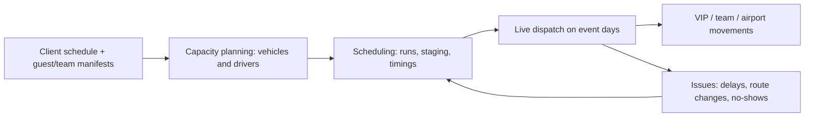

# Event fleet operations: case study

How I planned and ran transport for some of the world's biggest live events as Transport Operations Manager (Founder, Event Fleet Solutions), contracted to World Transportation Services (WTS), USA, 2024 to July 2026.

## Events
- **FIFA World Cup 2026:** Transport Manager for official sponsor Kia.
- **FIFA Club World Cup 2025:** Team Transport Manager for Paris Saint-Germain.
- **Super Bowl LX (2026)** and the **Grammy Awards**.
- **Formula 1:** all three US Grands Prix (Miami, Austin/COTA, Las Vegas).
- **ATP/WTA tennis:** Indian Wells, Miami Open, Charleston. **The Masters**, Augusta.

## Scale
- Fleets of **150+ vehicles** and their drivers.
- Airport, VIP and team movements with zero tolerance for delay.

## How the operation ran

- **Capacity:** sized the fleet and driver roster against the event schedule.
- **Scheduling:** built the movement plan per day, per group.
- **Live dispatch:** ran the fleet in real time and re-planned around changes.
- **Systems:** scoped a custom fleet management software solution with WTS to improve real-time visibility and vehicle utilisation.

## What carries over
Clear KPIs everyone can see, tight daily rhythms and systems that remove manual work, the same approach behind my [sales-control-system](https://github.com/marcdutoit58-max/sales-control-system).
